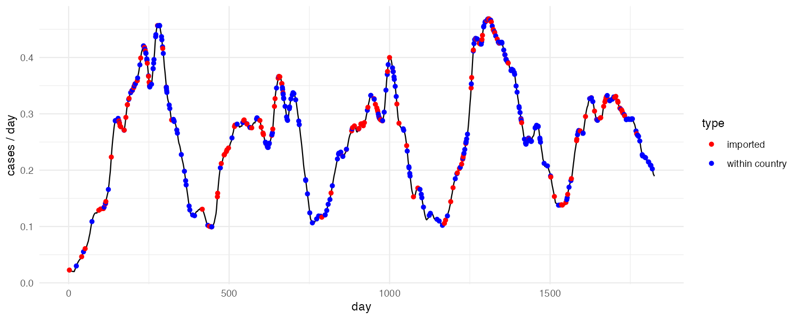
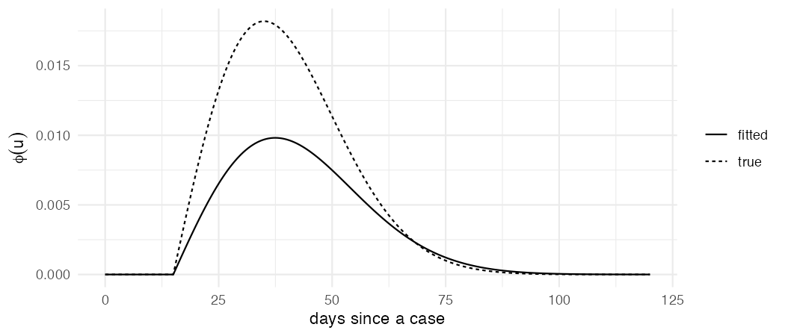
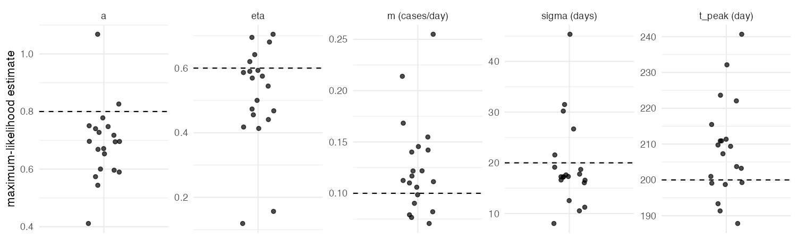
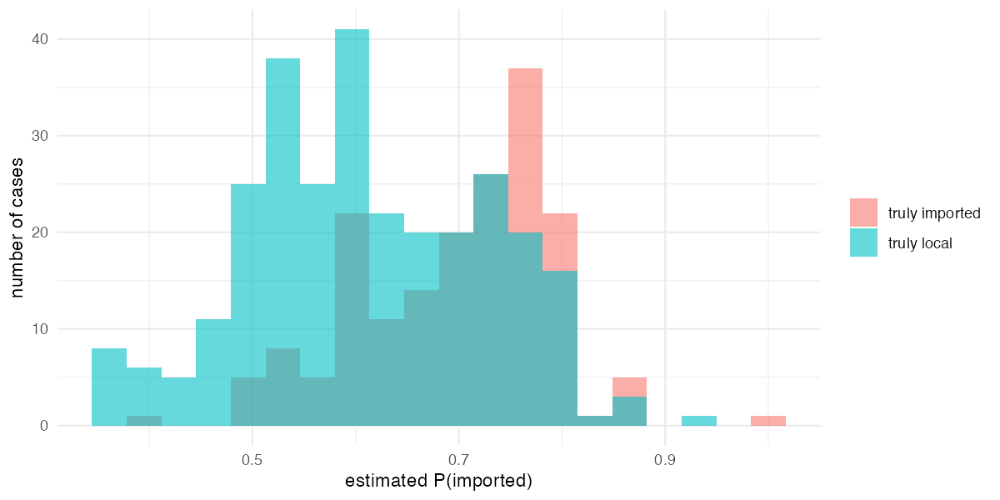

---
# An unpublished long-form version of the Hawkes project, written as a report. The live pages are the project card in _posts/projects/ and the write-up in _posts/blog/.
title: "Fitting a Hawkes process to simulated malaria cases (report)"
short: "Malaria Hawkes model (report)"
summary: "A self-exciting point process fitted to five years of simulated malaria cases, to see how well case timing alone recovers the level of local transmission and the origin of each case."
category: independent
when: oct 2026
links:
  - { label: repo, url: "https://github.com/timj-wood/hawkes-malaria" }
  - { label: the theory, url: /posts/hawkes-processes.html }
abstract: >-
  Unwin *et al.* (2021) separated imported from locally acquired malaria cases using only their timing, by fitting a Hawkes process whose background rate represents importation and whose kernel represents onward transmission. To test what case timing can and cannot recover, five years of cases were simulated from a known model, with a seasonal background averaging 0.1 cases per day, a branching ratio of η = 0.6 and a transmission delay of 15 days plus a Rayleigh spread of 20 days, and the model was refitted to the case times alone using the `epihawkes` package. The fit was sound but the estimates were not: η came out at 0.36 and the background at 0.165 per day, and across twenty replicate datasets η ranged from 0.1 to 0.7, trading off against the background throughout. Classifying individual cases as imported or local from their fitted probabilities did no better than chance. With a few hundred cases, timing constrains the overall level of transmission far better than it identifies where any one case came from, which is why the original study kept travel histories as a check.
---

## Introduction

In a country close to eliminating malaria, a newly reported case is either imported, infected abroad and a dead end locally, or the first visible link in a chain of local transmission: a mosquito bites the infected person and later bites someone else. The two call for different responses, but on the day of the report they are indistinguishable. [Unwin *et al.* (2021)](https://doi.org/10.1371/journal.pcbi.1008830) addressed this with a Hawkes process fitted to the timing of cases alone, separating imported from locally acquired malaria in Yunnan (China) and Eswatini, with travel histories used only as a check on the answer.

This report tests what case timing can and cannot recover. Five years of cases are simulated from a known model, so that the true transmission tree is available; the model is fitted to the case times alone; and the fitted parameters and the per-case probabilities of importation are compared with the truth. The theory behind the model is set out in a [companion explainer]({{ '/posts/hawkes-processes.html' | relative_url }}); the scripts are in the [repository](https://github.com/timj-wood/hawkes-malaria).

## Model

A Hawkes process is a point process whose conditional intensity, the rate of events at time $t$ given everything that has happened so far, is

$$
\lambda^{\ast}(t) = \mu(t) + \sum_{t_i < t} \eta\, g(t - t_i),
$$

where $\mu(t)$ is the **background rate**, here of imported cases; $\eta$ is the **branching ratio**, the average number of local cases each case causes, which is a reproduction number; and $g$ is the distribution of the **delay** between a case and the cases it causes (Hawkes, 1971). The probability that case $i$ was imported is the background's share of the intensity at the moment it occurred, $\mu(t_i)/\lambda^{\ast}(t_i)$, and the probability that case $j$ infected it is the share of $j$'s kernel.

The [`epihawkes`](https://github.com/mrc-ide/epihawkes) package of Unwin, Mishra and Bhatt provides the simulator, likelihood, gradient and intensity plot used throughout. It is not on CRAN:

```r
remotes::install_github("mrc-ide/epihawkes")
library(epihawkes)
```

Its parameterisation differs from the one above. The Rayleigh kernel, `ray_kernel()`, is

$$
\phi(u) = \alpha\,(u - d)\,e^{-\frac{1}{2}\delta (u - d)^2} \quad \text{for } u > d,
$$

where $d$ is a fixed delay; this is $\eta\, g(u)$ with $\sigma^2 = 1/\delta$ and $\eta = \alpha/\delta$. The seasonal background, `mu_sinusoidal_constant()`, is $A + M\cos(\omega t) + N\sin(\omega t)$ with $\omega = 2\pi/365.25$, which equals $m\,\big(1 + a\cos(2\pi(t - t_{\text{peak}})/365.25)\big)$ when $A = m$ and $(M, N) = m a\,(\cos \omega t_{\text{peak}}, \sin \omega t_{\text{peak}})$. Results are reported below in terms of $\eta$, $\sigma$, $m$, $a$ and $t_{\text{peak}}$, which have direct interpretations; $\alpha$, $\delta$, $A$, $M$ and $N$ are what the optimiser sees.

## Simulation

The simulated setting (with values chosen for illustration) is five years of cases in which imported cases arrive at a seasonal background rate averaging $m = 0.1$ per day, about three a month, with a strong annual cycle ($a = 0.8$) peaking around day 200; each case causes on average $\eta = 0.6$ local cases; and the delay $g$ is zero for 15 days, then follows a Rayleigh curve with spread $\sigma = 20$ days, so onward cases are most likely about five weeks later. With $\eta = 0.6$, about 60% of cases should be local and every chain should eventually die out.

```r
T_max <- 5 * 365
m <- 0.10; a <- 0.80; t_peak <- 200; eta <- 0.60; sigma <- 20; delay <- 15
w <- 2 * pi / 365.25

true <- list(alpha = eta / sigma^2, delta = 1 / sigma^2, delay = delay,
             A = m, M = m * a * cos(w * t_peak), N = m * a * sin(w * t_peak))
```

The package's `hawkes_simulation()` implements Ogata's thinning algorithm (Ogata, 1981): walk forward in time, bound the intensity over the near future, propose the next event at that bound, and accept it with probability $\lambda^{\ast}(t)/\text{bound}$. It works for any kernel and background because it only ever evaluates $\lambda^{\ast}(t)$. One run produced 438 cases.

```r
events_thin <- hawkes_simulation(events = c(0), T_max = T_max, kernel = ray_kernel,
                                 parameters = true, mu_fn = mu_sinusoidal_constant,
                                 mu_fn_diff = mu_diff_sinusoidal_constant, print_level = 0)
length(events_thin)   # 438
```

Thinning returns case times but not their origins, which the test requires. Cases were therefore simulated from the branching structure instead: imported cases are drawn from $\mu(t)$, each case is given $\text{Poisson}(\eta)$ children at delays of $15 + \text{Rayleigh}(\sigma)$ days, and the procedure repeats for each new generation until one is empty, recording every case's parent (`simulate_tree()` in the scripts, about fifteen lines). The two simulators produce the same process; one run of each gave 438 and 466 cases.

```r
tree     <- simulate_tree(T_max, true)
events   <- tree$times          # used from here on
imported <- tree$parent == 0    # the truth, for marking later
```

The tree run used from here on had 178 imported and 288 local cases, a local fraction of 0.62 against the 0.60 expected. Figure 1 shows its conditional intensity from the package's `plot_intensity_imported()`, with each case on the curve marked as imported or local (which the package calls "within country").

<figure>
  
  <figcaption>Figure 1. Conditional intensity of the simulated outbreak, with imported (red) and local (blue) cases marked.</figcaption>
</figure>

## Fitting

Taking only the case times, the parameters were fitted by maximum likelihood. The log-likelihood of a point process is

$$
\log L = \sum_i \log \lambda^{\ast}(t_i) - \int_0^T \lambda^{\ast}(t)\,dt
$$

(Rasmussen, 2018). The first term rewards high intensity at the moments cases actually occurred; the second, the *compensator*, charges for intensity everywhere else, so the model cannot win by making $\lambda^{\ast}$ large throughout. The integral splits into the area under the background (`mu_int_sinusoidal_constant()`) plus, for each case, $\eta$ times the fraction of its kernel that falls before the end of the window (`int_ray()`). The package's `neg_log_likelihood()` and `ray_derivatives()` give the objective and its analytic gradient, derived in the paper's S2 Text. Following the paper, the objective was minimised with BFGS from ten random starts, keeping the best:

```r
fit_once <- function(events, start) {
  optim(par = start, fn = neg_log_likelihood, gr = ray_derivatives, method = "BFGS",
        events = events, delay = delay, kernel = ray_kernel,
        mu_fn = mu_sinusoidal_constant, mu_diff_fn = mu_diff_sinusoidal_constant,
        mu_int_fn = mu_int_sinusoidal_constant, print_level = 0)
}

fits <- lapply(1:10, function(k) fit_once(events, random_start()))
best <- fits[[which.min(sapply(fits, `[[`, "value"))]]
fit  <- as.list(best$par); fit$delay <- delay   # optim drops the fixed delay
```

where `random_start()` draws each parameter uniformly from a sensible range (`fit_epihawkes()` in the scripts does all of this in one go). Most starts converged to the same optimum.

| Parameter | True | Estimate |
|:----------|-----:|---------:|
| Mean background rate, $m$ (cases/day) | 0.10 | 0.165 |
| Seasonal amplitude, $a$ | 0.80 | 0.58 |
| Peak day, $t_{\text{peak}}$ | 200 | 220 |
| Branching ratio, $\eta$ | 0.60 | 0.36 |
| Delay spread, $\sigma$ (days) | 20 | 22.5 |

Figure 2 compares the fitted kernel with the true one: the same shape with a smaller area, the area under the kernel being $\eta$.

<figure>
  
  <figcaption>Figure 2. The fitted kernel against the true one.</figcaption>
</figure>

The background is estimated too high and $\eta$ too low. Three checks indicate that this is a property of the data rather than of the fit: the analytic gradient matches a numerical gradient to six figures; the optimiser started at the true parameters moves to the same estimate; and that estimate has a higher likelihood than the truth. With a handful of cases a week, "more importation, less transmission" and "less importation, more transmission" produce similar case timings, and this particular five years happened to resemble the former. Repeating the simulation and fit on twenty datasets (Figure 3) shows the estimates scattered around the true values, with $\eta$ anywhere from 0.1 to 0.7 and the background pulled up whenever $\eta$ is pulled down. The two trade off against each other, and 450 cases are not enough to pin both down. The paper addressed this by comparing fits across different background terms.

<figure>
  
  <figcaption>Figure 3. Parameter estimates across twenty simulated datasets; dashed lines are the true values.</figcaption>
</figure>

## Classifying cases

Each case's probability of importation follows from the fitted model in a few lines:

```r
lags    <- outer(events, events, "-")                 # lags[i, j] = t_i - t_j
contrib <- ray_kernel(lags, fit) * (lags > fit$delay) # earlier cases' pull on each case
mu_i    <- mu_sinusoidal_constant(events, fit)
p_imported <- mu_i / (mu_i + rowSums(contrib))
```

Figure 4 splits these probabilities by the truth from the simulated tree. The two distributions overlap heavily, and thresholding at 0.5 labels fewer than half the cases correctly, no better than guessing. Case timing constrains how much transmission there is, in aggregate and over years, but says little about where any individual case came from.

<figure>
  
  <figcaption>Figure 4. Estimated probability of importation for cases that were in fact imported and local.</figcaption>
</figure>

Two parameters govern this. A sharper kernel (for example $\sigma = 5$) improves individual classification considerably, because "five weeks after a case" becomes a precise statement. A branching ratio near 0.9 makes chains long, so excitation dominates the intensity and the background becomes hard to see.

## Discussion

The model answers a population-level question well and an individual-level question badly. The branching ratio, read as a case reproduction number, and the background importation rate are only jointly constrained by a few hundred case times, so either should be reported alongside the other; and the probability that a given case was imported carries little information beyond the season in which it occurred. The value of the approach in Unwin *et al.* lies in the aggregate estimate of remaining local transmission, confirmed against travel histories, rather than in labelling cases. The fitting itself is a few dozen lines of R on top of `epihawkes`.

## References
{: .unnumbered}

- Hawkes, A. G. (1971). Spectra of some self-exciting and mutually exciting point processes. *Biometrika* 58(1): 83–90. [doi:10.1093/biomet/58.1.83](https://doi.org/10.1093/biomet/58.1.83)
- Ogata, Y. (1981). On Lewis' simulation method for point processes. *IEEE Transactions on Information Theory* 27(1): 23–31.
- Rasmussen, J. G. (2018). Lecture notes: temporal point processes and the conditional intensity function. [arXiv:1806.00221](https://arxiv.org/abs/1806.00221)
- Unwin, H. J. T. *et al.* (2021). Using Hawkes processes to model imported and local malaria cases in near-elimination areas. *PLOS Computational Biology* 17(4): e1008830. [doi:10.1371/journal.pcbi.1008830](https://doi.org/10.1371/journal.pcbi.1008830)
- Unwin, H. J. T., Mishra, S. & Bhatt, S. `epihawkes`, an R package. [github.com/mrc-ide/epihawkes](https://github.com/mrc-ide/epihawkes)
