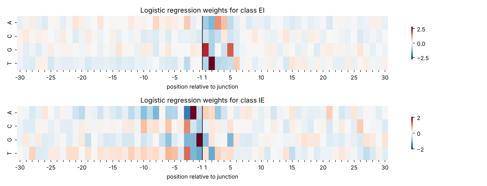
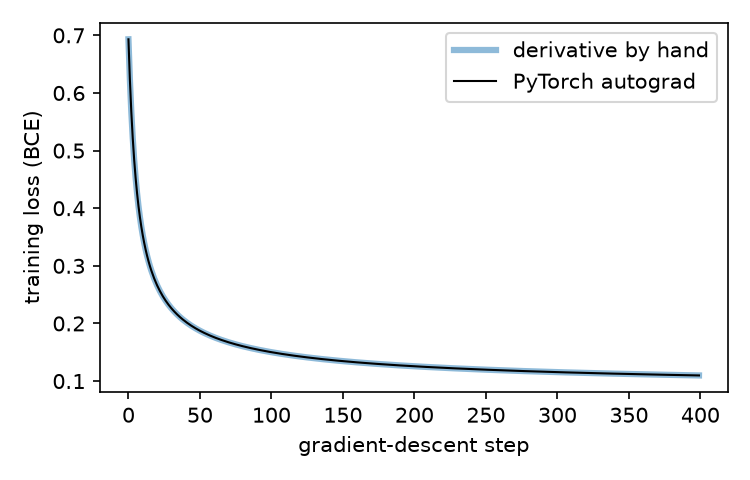
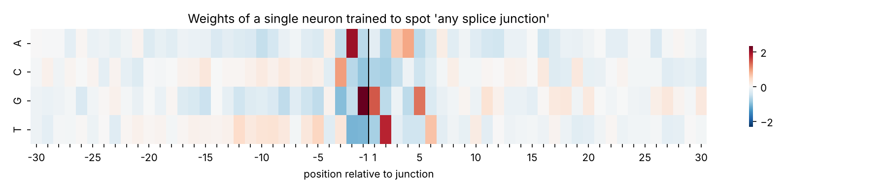
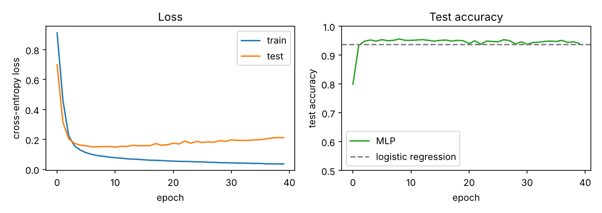

## Introduction

Transcription of a eukaryotic gene yields a pre-mRNA that retains its introns, which must be excised before translation. The boundaries of almost every intron carry a short consensus: GT at the exon–intron (donor, 5′) junction and AG at the intron–exon (acceptor, 3′) junction, the GT–AG rule first described by Breathnach *et al.* (1978) and reviewed by Breathnach and Chambon (1981). Catalogues of junction sequences established the extended consensus, including a pyrimidine-rich tract upstream of the acceptor site (Mount, 1982; Shapiro and Senapathy, 1987). Because the rule is near-universal, splice-junction recognition from sequence is a classification problem whose principal feature is known in advance. This makes it a convenient setting in which to compare models and to check that a model has learnt a biologically interpretable signal rather than an artefact of the data.

The problem was an early test case for neural networks applied to sequence data. Noordewier, Towell and Shavlik (1991) trained knowledge-based networks on the dataset analysed here, and Towell and Shavlik (1994) later used the same data to evaluate their KBANN system against backpropagation networks, nearest-neighbour classifiers and canonical pattern matching.

The present study addresses a narrower question. Given a 60-base window, can a model decide whether a splice junction lies at its centre and, if so, of which kind; and does a small neural network offer any advantage over a linear classifier? Two conventional classifiers were fitted as baselines. A single artificial neuron was trained by gradient descent with gradients derived analytically and verified against an automatic-differentiation implementation. A multilayer perceptron with one hidden layer was then trained and compared with the baselines. All code and figures are available in the accompanying [repository](https://github.com/timj-wood/splice-site-nn).

## Materials and methods

### Data

The splice-junction dataset of the UCI Machine Learning Repository (Towell, Noordewier and Shavlik, 1991) comprises 3,190 windows of 60 bases from primate genes in GenBank 64.1, each labelled `EI` (exon–intron, donor), `IE` (intron–exon, acceptor) or `N` (neither). The junction, where present, lies between positions 30 and 31 of the window. Positions are reported here relative to the junction, so that +1 is the first intronic base of a donor site.

### Encoding

Each sequence was one-hot encoded: every position was expanded into four indicator columns, one per base, giving a feature vector of length 240 in which each element represents one base at one position. A model with one weight per feature can therefore attribute evidence to a specific base at a specific position independently of all others. Sixty of the 191,400 positions carry IUPAC ambiguity codes (for example `D`, denoting A, G or T). Rather than discard the affected sequences, the unit of probability mass was divided equally among the permitted bases, so that `D` was encoded as 1/3 for each of A, G and T.

### Models

*Baselines.* Multinomial logistic regression and *k*-nearest neighbours (Cover and Hart, 1967) were fitted on the three-class problem using scikit-learn (Pedregosa *et al.*, 2011). Logistic regression was fitted by L-BFGS (Liu and Nocedal, 1989) with a maximum of 2,000 iterations. For *k*-nearest neighbours, *k* was selected from {1, 3, 5, 7, 11, 15, 21, 31} by five-fold cross-validation on the training set.

*Single neuron.* An artificial neuron computes a weighted sum of its inputs plus a bias and passes the result through a non-linear activation,

$$
z = \sum_j w_j x_j + b,
\qquad a = \sigma(z) = \frac{1}{1 + e^{-z}},
$$

where the logistic sigmoid $\sigma$ maps the pre-activation to the interval (0, 1), so that the output may be read as a probability. Having a single output, the neuron was trained on the binary formulation of the task, junction present (`EI` or `IE`, labelled 1) or absent (`N`, labelled 0), with the binary cross-entropy loss

$$
\ell = -[y \log a + (1-y)\log(1-a)],
$$

for label $y$ and prediction $a$. By the chain rule through $z$ and $a$: $\partial z/\partial w_j = x_j$, $\partial a/\partial z = a(1-a)$ for the sigmoid, and $\partial \ell/\partial a = (a-y)/(a(1-a))$ for cross-entropy. The last two factors cancel, giving

$$
\frac{\partial \ell}{\partial w_j} = (a - y)\, x_j, \qquad
\frac{\partial \ell}{\partial b} = a - y.
$$

The gradient for each weight is thus the prediction error multiplied by the corresponding input, which is why the sigmoid and cross-entropy are conventionally paired. Averaged over the training set and expressed as a matrix product, this yields a full-batch gradient-descent update that was implemented directly in PyTorch tensor operations (Paszke *et al.*, 2019). The same model was then constructed with the library's `nn.Linear`, `BCEWithLogitsLoss` and automatic differentiation (`loss.backward()`) under identical initialisation, learning rate and step count, so that the two implementations could be compared.

*Multilayer perceptron.* A feed-forward network with 240 inputs, a single hidden layer of 32 units with rectified-linear activation (Nair and Hinton, 2010), $f(z) = \max(0, z)$, and three outputs was trained on the three-class problem with the cross-entropy loss by backpropagation (Rumelhart, Hinton and Williams, 1986). A hidden layer permits conjunctions of features (for instance G at +1 *and* T at +2 *and* a pyrimidine-rich region upstream) that a weighted sum cannot represent. Unlike the single neuron, the network cannot be initialised at zero, since all hidden units would then compute identical outputs and receive identical gradients; the library's default random initialisation was used.

### Training and evaluation

A stratified quarter of the data (798 sequences) was held out as a test set and not used during training or model selection; the remaining 2,392 sequences formed the training set (`random_state = 42`). Training settings are given in Table 1. The single neuron was trained by full-batch gradient descent; the multilayer perceptron by stochastic gradient descent with shuffled mini-batches. Performance is reported as classification accuracy on the held-out set. For the binary single-neuron task, accuracy is computed against the binary labels and is therefore not directly comparable with the three-class figures.

**Table 1.** Training settings.

| Model | Loss | Optimiser | Learning rate | Batch | Steps / epochs | Initialisation |
|:------|:-----|:----------|--------------:|------:|---------------:|:---------------|
| Logistic regression | multinomial cross-entropy | L-BFGS | – | full | ≤ 2,000 iterations | – |
| *k*-nearest neighbours | – | – | – | – | *k* by 5-fold CV | – |
| Single neuron (both implementations) | binary cross-entropy | gradient descent | 0.5 | full (2,392) | 400 steps | zeros |
| Multilayer perceptron | cross-entropy | SGD | 0.1 | 64 | 40 epochs | PyTorch default |

## Results

### Baselines

Logistic regression achieved **93.7%** accuracy on the test set and *k*-nearest neighbours **85.1%** (Table 2). The gap is consistent with the geometry of one-hot vectors in 240 dimensions: two unrelated 60-base windows differ at most positions, so nearly all pairs of sequences lie at similar distances and the identity of the nearest neighbours carries little information (Beyer *et al.*, 1999). The nearest-neighbour result is in keeping with the poor performance of that method reported by the dataset's contributors (Towell and Shavlik, 1994).

Because the logistic model has one weight per (position, base) for each class, its weights can be arranged as a 4 × 60 grid and inspected directly (Figure 1). For the `EI` class the largest weights are T at +2 and G at +1; for `IE`, G at −1 and A at −2, with C and T favoured over a stretch further upstream, consistent with the polypyrimidine tract that precedes acceptor sites (Mount, 1982). The linear model therefore recovers the GT…AG consensus unaided.

<figure>
  
  <figcaption>Figure 1. Logistic-regression weights by position (relative to the junction) and base, for the EI and IE classes.</figcaption>
</figure>

### Single neuron

After 400 steps of gradient descent the neuron achieved **93.4%** on the binary task. The loss curves of the analytical-gradient and automatic-differentiation implementations coincide (Figure 2), and their final weight vectors agree to within $2 \times 10^{-7}$; for this model, automatic differentiation reproduces the hand-derived gradient exactly.

<figure>
  
  <figcaption>Figure 2. Training loss by step for the neuron with the gradient derived analytically (blue) and with automatic differentiation (black).</figcaption>
</figure>

The neuron's weights admit the same arrangement as the logistic model's (Figure 3). The four largest are G at −1, A at −2, T at +2 and G at +1: AG immediately upstream of the junction and GT immediately downstream. Because the binary label pools the two junction classes, both halves of the consensus are learnt by a single set of weights.

<figure>
  
  <figcaption>Figure 3. Weights of the single neuron by position and base; positive values are evidence for a junction.</figcaption>
</figure>

### Multilayer perceptron

The network achieved **94.0%** on the test set. Training loss decreased throughout the 40 epochs, whereas test loss reached its minimum at approximately epoch 7 and rose slowly thereafter while test accuracy remained essentially constant (Figure 4). The hidden layer provides sufficient capacity to begin fitting the training sequences specifically, with the additional confidence accruing mainly to examples already classified correctly.

<figure>
  
  <figcaption>Figure 4. Multilayer perceptron: training and test loss by epoch (left), and test accuracy by epoch against the logistic-regression baseline (right).</figcaption>
</figure>

### Summary

**Table 2.** Classification accuracy on the held-out test set (798 sequences).

| Model | Task | Test accuracy |
|:------|:-----|--------------:|
| Logistic regression | 3-class | 93.7% |
| *k*-nearest neighbours | 3-class | 85.1% |
| Single neuron, analytical gradient | binary | 93.4% |
| Single neuron, automatic differentiation | binary | 93.4% |
| Multilayer perceptron, 32 hidden units | 3-class | 94.0% |

## Discussion

The multilayer perceptron's advantage over logistic regression, 0.3 percentage points on 798 test sequences, is within the variation that a different train–test partition would be expected to produce, and the divergence of training and test loss shows the network overfitting from early in training. Early stopping (Prechelt, 1998) or regularisation would address the overfitting but would not be expected to alter the ranking of the models. The result is in keeping with Noordewier *et al.* (1991), who reported approximately 94.5% for a standard backpropagation network on these data given sufficient training examples, and with the error rates for backpropagation and perceptron classifiers tabulated by Towell and Shavlik (1994).

The most plausible explanation is that the splice signal within a 60-base window is close to additive: a small number of positions each contribute evidence independently, so a linear combination of position-specific features already captures most of the available information and the capacity added by a hidden layer has little left to exploit. The agreement between the logistic weights, the neuron weights and the consensus catalogued by Mount (1982) and Shapiro and Senapathy (1987) supports this reading. It is also consistent with the long-standing use of position-specific weight matrices, which are linear in exactly this sense, as the standard model of splice-site signals (Shapiro and Senapathy, 1987).

Several limitations apply. All results rest on a single stratified split; confidence intervals or repeated partitions would be needed to quantify the uncertainty in the reported accuracies, and the comparison between models should be read with that in mind. The network's hyperparameters were not tuned and no regularisation was applied. The dataset is small by current standards and restricted to primate sequences, so the findings concern this benchmark rather than splice-site prediction in general, where longer context, dependence between positions, and severe class imbalance across a genome all matter (Burge and Karlin, 1997).

## Conclusion

On the UCI splice-junction benchmark, a one-hot encoding and a linear classifier recover the GT…AG consensus and reach 93.7% accuracy; a single neuron trained with an analytically derived gradient matches an automatic-differentiation implementation exactly and learns the same consensus; and a small multilayer perceptron offers no reliable improvement. For this problem the useful signal is largely linear in position-specific base identity, and the appropriate baseline for any more elaborate model is the linear one.

## References
{: .unnumbered}

Beyer, K., Goldstein, J., Ramakrishnan, R. & Shaft, U. (1999) When is "nearest neighbor" meaningful? In C. Beeri & P. Buneman (eds), *Database Theory — ICDT'99*, Lecture Notes in Computer Science 1540, pp. 217–235. Springer. [doi:10.1007/3-540-49257-7_15](https://doi.org/10.1007/3-540-49257-7_15)

Breathnach, R., Benoist, C., O'Hare, K., Gannon, F. & Chambon, P. (1978) Ovalbumin gene: evidence for a leader sequence in mRNA and DNA sequences at the exon–intron boundaries. *Proceedings of the National Academy of Sciences USA* 75(10), 4853–4857. [doi:10.1073/pnas.75.10.4853](https://doi.org/10.1073/pnas.75.10.4853)

Breathnach, R. & Chambon, P. (1981) Organization and expression of eucaryotic split genes coding for proteins. *Annual Review of Biochemistry* 50, 349–383. [doi:10.1146/annurev.bi.50.070181.002025](https://doi.org/10.1146/annurev.bi.50.070181.002025)

Burge, C. & Karlin, S. (1997) Prediction of complete gene structures in human genomic DNA. *Journal of Molecular Biology* 268(1), 78–94. [doi:10.1006/jmbi.1997.0951](https://doi.org/10.1006/jmbi.1997.0951)

Cover, T. & Hart, P. (1967) Nearest neighbor pattern classification. *IEEE Transactions on Information Theory* 13(1), 21–27. [doi:10.1109/TIT.1967.1053964](https://doi.org/10.1109/TIT.1967.1053964)

Liu, D. C. & Nocedal, J. (1989) On the limited memory BFGS method for large scale optimization. *Mathematical Programming* 45, 503–528. [doi:10.1007/BF01589116](https://doi.org/10.1007/BF01589116)

Mount, S. M. (1982) A catalogue of splice junction sequences. *Nucleic Acids Research* 10(2), 459–472. [doi:10.1093/nar/10.2.459](https://doi.org/10.1093/nar/10.2.459)

Nair, V. & Hinton, G. E. (2010) Rectified linear units improve restricted Boltzmann machines. *Proceedings of the 27th International Conference on Machine Learning (ICML)*, pp. 807–814. Omnipress.

Noordewier, M. O., Towell, G. G. & Shavlik, J. W. (1991) Training knowledge-based neural networks to recognize genes in DNA sequences. *Advances in Neural Information Processing Systems* 3, 530–536. Morgan Kaufmann. [pdf](https://proceedings.neurips.cc/paper/1990/file/8efb100a295c0c690931222ff4467bb8-Paper.pdf)

Paszke, A., Gross, S., Massa, F., Lerer, A., Bradbury, J., Chanan, G., Killeen, T., Lin, Z., Gimelshein, N., Antiga, L., Desmaison, A., Köpf, A., Yang, E., DeVito, Z., Raison, M., Tejani, A., Chilamkurthy, S., Steiner, B., Fang, L., Bai, J. & Chintala, S. (2019) PyTorch: an imperative style, high-performance deep learning library. *Advances in Neural Information Processing Systems* 32, 8024–8035.

Pedregosa, F., Varoquaux, G., Gramfort, A., Michel, V., Thirion, B., Grisel, O., Blondel, M., Prettenhofer, P., Weiss, R., Dubourg, V., Vanderplas, J., Passos, A., Cournapeau, D., Brucher, M., Perrot, M. & Duchesnay, É. (2011) Scikit-learn: machine learning in Python. *Journal of Machine Learning Research* 12, 2825–2830.

Prechelt, L. (1998) Early stopping — but when? In G. B. Orr & K.-R. Müller (eds), *Neural Networks: Tricks of the Trade*, Lecture Notes in Computer Science 1524, pp. 55–69. Springer. [doi:10.1007/3-540-49430-8_3](https://doi.org/10.1007/3-540-49430-8_3)

Rumelhart, D. E., Hinton, G. E. & Williams, R. J. (1986) Learning representations by back-propagating errors. *Nature* 323, 533–536. [doi:10.1038/323533a0](https://doi.org/10.1038/323533a0)

Shapiro, M. B. & Senapathy, P. (1987) RNA splice junctions of different classes of eukaryotes: sequence statistics and functional implications in gene expression. *Nucleic Acids Research* 15(17), 7155–7174. [doi:10.1093/nar/15.17.7155](https://doi.org/10.1093/nar/15.17.7155)

Towell, G. G., Noordewier, M. O. & Shavlik, J. W. (1991) Molecular Biology (Splice-junction Gene Sequences)* [dataset]. UCI Machine Learning Repository. [doi:10.24432/C5M888](https://doi.org/10.24432/C5M888)

Towell, G. G. & Shavlik, J. W. (1994) Knowledge-based artificial neural networks. *Artificial Intelligence* 70(1–2), 119–165. [doi:10.1016/0004-3702(94)90105-8](https://doi.org/10.1016/0004-3702(94)90105-8)
