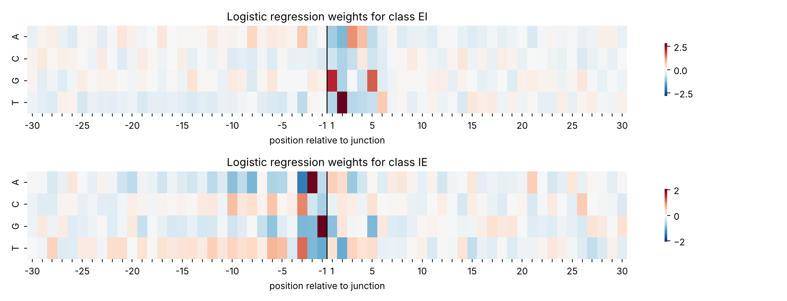
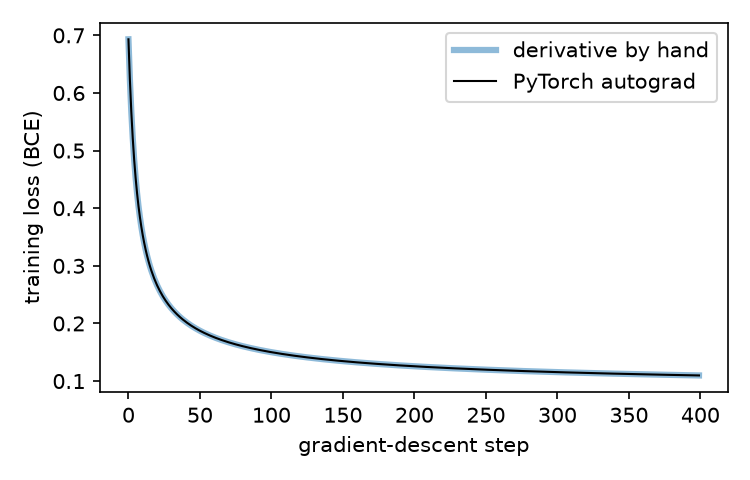
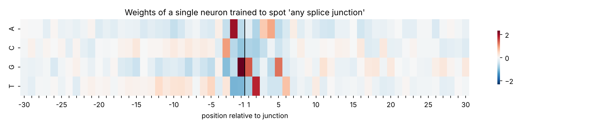
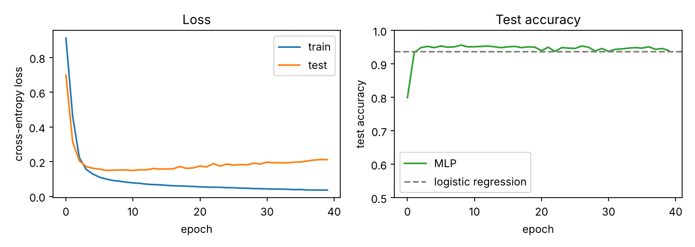

This post details my first attempt at creating a neural network, applied to a problem in genomics with a known answer - making interpretation easy. I had not used machine learning before this, but its place in bioinformatics is now hard to ignore, so building some competence in it has become a priority. This post is not an introduction to the theory, which I am still learning; for that, 3Blue1Brown's lessons and [Nielsen's](http://neuralnetworksanddeeplearning.com/) online book are good places to start. For the code I have followed the Jean Golding Institute's *Data Analysis in Python (Part 2)* and *Introduction to AI* courses. All figures and numbers come from the scripts in the [repository](https://github.com/timj-wood/splice-site-nn).

## RNA splicing and rationale

When a gene is transcribed, the pre-mRNA still contains its introns, which must be removed before translation. The boundaries of almost every intron carry a short consensus: GT at the exon–intron (donor) junction and AG at the intron–exon (acceptor) junction, the GT–AG rule, first described in the late 1970s. Later catalogues of junction sequences established an extended consensus, including a pyrimidine-rich tract upstream of acceptor sites (Mount, 1982). Because the rule is near-universal, it makes a good first target: I know what the answer should look like, so I can tell whether a model has learnt something sensible or something strange.

The question I put to each model is: given a window of 60 bases, is there a splice junction at its centre, and if so, which kind? The aim is a model that learns the GT…AG pattern by itself. Before that, I fit some ordinary classifiers so there is something to compare the network against.

## The data

The UCI [splice-junction dataset](https://doi.org/10.24432/C5M888) (Towell, Noordewier and Shavlik, 1991) has 3,190 windows of 60 bases from primate genes, each labelled `EI` (exon to intron, a donor site), `IE` (intron to exon, an acceptor site) or `N` (neither). It was assembled for one of the first studies to apply neural networks to DNA sequence (Noordewier, Towell and Shavlik, 1991), which makes it a fitting choice. Positions below are given relative to the junction, so +1 is the first intronic base of a donor site.

A string of bases such as `CCAGTCAT…` is not a suitable input for a model. The standard fix is one-hot encoding, for which I used an existing [implementation](https://github.com/angai4/dna-one-hot-encoder/tree/main). Each position becomes four columns, one per base, with a 1 in the column for the base present and 0 in the other three, so each sequence becomes a row of 240 values. Each column now represents one base at one position, and a model with one weight per column can learn how much evidence a G at position +1 provides, independently of every other base and position.

A few positions (60 of 191,400) carry [IUPAC ambiguity codes](https://www.dnabaser.com/articles/IUPAC%20ambiguity%20codes.html); `D`, for example, means A, G or T. Rather than discard those sequences, I spread the 1 evenly over the possible bases, so a `D` becomes $\frac{1}{3}$, $\frac{1}{3}$, $\frac{1}{3}$ for A, G and T. I am not certain this is standard practice, but it is defensible and affects only a handful of entries.

```python
X = np.stack([one_hot_encode(s) for s in data["sequence"]]) # encode each sequence, then stack into a (3190, 240) array
y = data["label"].values
```

## A baseline from classical methods

First, a quarter of the data (798 sequences) is held back as a test set that no model sees during training; without it there is no way to tell whether a model has learnt anything.

```python
from sklearn.model_selection import train_test_split

X_train, X_test, y_train, y_test = train_test_split(
    X, y, test_size=0.25, random_state=42, stratify=y
)
```

Logistic regression, fitted with [scikit-learn](https://scikit-learn.org/), is the natural baseline.

```python
from sklearn.linear_model import LogisticRegression
from sklearn.metrics import accuracy_score

logreg = LogisticRegression(max_iter=2000)
logreg.fit(X_train, y_train)

pred = logreg.predict(X_test)
print(f"Logistic regression test accuracy: {accuracy_score(y_test, pred):.3f}")
```

It classified **93.7%** of the test sequences correctly, higher than I expected from a linear model. I also tried $k$-nearest neighbours, choosing $k$ by cross-validation as the JGI course does:

```python
from sklearn.neighbors import KNeighborsClassifier
from sklearn.model_selection import GridSearchCV

hyperparameters = {"n_neighbors": [1, 3, 5, 7, 11, 15, 21, 31]}
model = GridSearchCV(KNeighborsClassifier(), hyperparameters)
model.fit(X_train, y_train)

print(model.best_estimator_)
print(f"kNN test accuracy: {model.score(X_test, y_test):.3f}")
```

This was markedly worse, at **85.1%**. The likely reason is how distances behave between one-hot vectors in 240 dimensions: two unrelated 60-base sequences differ at most positions, so almost every pair ends up roughly the same distance apart and the nearest neighbours carry little information. The dataset's own contributors reported similarly poor nearest-neighbour results.

The logistic model is simple, but its weights are readable. It has one weight per (position, base) for each class, so the 240 weights can be reshaped into a 4 × 60 grid and plotted:

```python
W = logreg.coef_[list(logreg.classes_).index("EI")]   # 240 weights for the EI class
grid = W.reshape(60, 4).T                               # 4 bases × 60 positions
```



For `EI`, the largest weights are T at +2 and G at +1. For `IE`, they are G at −1 and A at −2, with C and T favoured over a stretch further upstream, which is the polypyrimidine tract that precedes acceptor sites (Mount, 1982). The linear model has therefore already found GT…AG, and the neural network will have to at least match it to justify itself.

## Building a neuron from scratch

A single artificial neuron does two things. It takes a weighted sum of its inputs and adds a bias (aggregation), then passes that sum through a non-linear function (activation):

$$
z = \sum_j w_j x_j + b,
\qquad a = \sigma(z) = \frac{1}{1 + e^{-z}}.
$$

The sigmoid $\sigma$ compresses any number into the range 0 to 1, so the output can be read as a probability. To keep to a single output, I started with the binary version of the problem, "is there *any* splice junction in this window?", with `EI` or `IE` labelled 1 and `N` labelled 0.

Training needs a measure of how wrong the model is, the loss, and for binary classification the standard choice is binary cross-entropy,

$$
\ell = -[y \log a + (1-y)\log(1-a)],
$$

where $y$ is the label and $a$ the predicted probability; lower is better. To improve the weights, we need to know how the loss changes when each weight is nudged. The weight $w_j$ affects $z$, which affects $a$, which affects $\ell$, and the chain rule multiplies the three sensitivities together: $\partial z/\partial w_j = x_j$, $\partial a/\partial z = a(1-a)$ for the sigmoid, and $\partial \ell/\partial a = (a-y)/(a(1-a))$ for cross-entropy. The last two cancel, which leaves

$$
\frac{\partial \ell}{\partial w_j} = (a - y)\, x_j, \qquad
\frac{\partial \ell}{\partial b} = a - y.
$$

The gradient for each weight is the error times the input it multiplies. If the neuron was confidently wrong about a sequence that had a G at +1, the weight for G at +1 receives a large correction; if that feature was absent, the weight is unchanged. The cancellation is not an accident, and is the reason sigmoid and cross-entropy are usually paired. Averaged over all 2,392 training sequences and written as a matrix product, the whole training loop is a few lines of [PyTorch](https://pytorch.org/):

```python
def sigmoid(z):
    return 1 / (1 + torch.exp(-z))

w = torch.zeros(240, 1)   # one weight per (position, base)
b = torch.zeros(1)
lr, n = 0.5, len(X_train)

for epoch in range(400):
    z = X_train @ w + b            # aggregate
    a = sigmoid(z)                 # activate
    grad_z = (a - y_train) / n     # how wrong, on average
    w -= lr * (X_train.T @ grad_z) # the gradient step
    b -= lr * grad_z.sum()
```

After 400 steps of plain gradient descent, this scored **93.4%** on the binary task, which is not directly comparable with the three-class 93.7% above.

I then built the same neuron the way the JGI course does, with `nn.Linear(240, 1)`, `BCEWithLogitsLoss` and `loss.backward()`, using the same learning rate, number of steps and zero initialisation:

```python
neuron = nn.Linear(240, 1)
nn.init.zeros_(neuron.weight); nn.init.zeros_(neuron.bias)
loss_fn = nn.BCEWithLogitsLoss()               # sigmoid + cross-entropy in one
optimiser = torch.optim.SGD(neuron.parameters(), lr=0.5)

for epoch in range(400):
    optimiser.zero_grad()
    loss = loss_fn(neuron(X_train), y_train)
    loss.backward()                            # PyTorch works out the gradients
    optimiser.step()                           # w -= lr * grad
```

{: .narrow}

The two loss curves sit on top of each other, and the final weights agree to within $2 \times 10^{-7}$. For a single neuron, then, `loss.backward()` is exactly the chain rule applied above, automated. Backpropagation proper is the same idea applied layer by layer, storing intermediate values so that nothing is computed twice, though I have not tested that part myself. Building a neuron by hand was a useful exercise; PyTorch does all of it for you, and in practice that is what you should use.

## What the neuron learnt

Because a single neuron has one weight per (position, base), its 240 weights can be plotted in the same way as the logistic regression ones:



The four largest weights, in order, are G at −1, A at −2, T at +2 and G at +1: AG to the left of the junction and GT to the right. Since this neuron was only asked whether a junction of *either* kind was present, it picked up both signals at once. I had hoped for this, but it was still satisfying to see it emerge from nothing more than 240 columns of ones and zeros.

## Adding a hidden layer

A single neuron can only add up independent pieces of evidence. A hidden layer lets the network combine features (something like "G at +1 *and* T at +2 *and* a run of C and T before it"), which a weighted sum cannot do. So I built a small multilayer perceptron: 240 inputs, a hidden layer of 32 units with ReLU activation, $f(z) = \max(0, z)$, and three outputs for `EI`, `IE` and `N`, trained with mini-batch stochastic gradient descent for 40 epochs.

```python
mlp = nn.Sequential(
    nn.Linear(240, 32),
    nn.ReLU(),
    nn.Linear(32, 3),
)
loss_fn = nn.CrossEntropyLoss()
optimiser = torch.optim.SGD(mlp.parameters(), lr=0.1)

for epoch in range(40):
    for idx in torch.randperm(len(X_train)).split(64):   # shuffled mini-batches
        optimiser.zero_grad()
        loss = loss_fn(mlp(X_train[idx]), y_train_idx[idx])
        loss.backward()
        optimiser.step()
```

Two things I learnt along the way:

1. The weights cannot all start at zero this time. Every hidden unit would compute the same thing, receive the same gradient and stay identical forever (and with ReLU they would all be stuck at zero), so PyTorch's random initialisation is used instead.
2. Rather than one gradient step over all 2,392 sequences per epoch, the network takes a step after every 64. That is the "stochastic" part of stochastic gradient descent.



It reached **94.0%** on the test set, against 93.7% for logistic regression. That is effectively a tie: a difference this small, on 798 test sequences, is within what a different train–test split could produce.

The loss plot turned out to be the most informative part. Training loss keeps falling for all 40 epochs, but test loss bottoms out around epoch 7 and then climbs slowly. This is overfitting: the 32 hidden units have enough capacity to start memorising the training sequences, and the extra confidence goes mostly on examples the network already classifies correctly, which is why test accuracy barely moves. Early stopping or regularisation would address it, though neither would be expected to change the ranking of the models. I had read about both before, but it was much clearer seeing it happen in my own plot.

In hindsight, the tie is not surprising. Noordewier *et al.* (1991) found much the same, with a plain backpropagation network reaching about 94.5% once it had enough training examples. My reading is that the splice signal within a 60-base window is largely additive, a few positions each contributing on their own, so a linear model captures most of it and the extra capacity has little left to find. That is also why position-specific weight matrices, which are linear in exactly this sense, have long been the standard model of splice-site signals. I had half expected the network to win simply because it was a neural network; this was a useful correction. Whether the conclusion holds beyond this benchmark is another matter: genome-scale splice-site prediction involves longer context, dependence between positions and severe class imbalance.

## References
{: .unnumbered}

Mount, S. M. (1982) A catalogue of splice junction sequences. *Nucleic Acids Research* 10(2), 459–472. [doi:10.1093/nar/10.2.459](https://doi.org/10.1093/nar/10.2.459)

Noordewier, M. O., Towell, G. G. & Shavlik, J. W. (1991) Training knowledge-based neural networks to recognize genes in DNA sequences. *Advances in Neural Information Processing Systems* 3, 530–536. Morgan Kaufmann. [pdf](https://proceedings.neurips.cc/paper/1990/file/8efb100a295c0c690931222ff4467bb8-Paper.pdf)

Towell, G. G., Noordewier, M. O. & Shavlik, J. W. (1991) Molecular Biology (Splice-junction Gene Sequences) [dataset]. UCI Machine Learning Repository. [doi:10.24432/C5M888](https://doi.org/10.24432/C5M888)