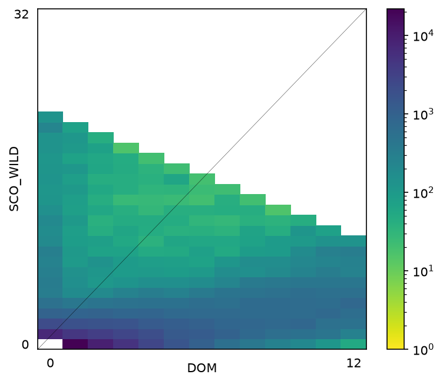

 An unlisted page: not in any folder on the home page, only reachable by its address. 

This site is built by hand on [Jekyll](https://jekyllrb.com/) and hosted on GitHub Pages. This page shows every format in one place, so I can check nothing has broken and look things up when I forget. It isn't listed anywhere on the site.

## How the site is organised

The home page is a folder tree on the green cover. Each folder shows its newest three items, and the folder name links to a page of its own: the same tree, trimmed to that folder, with everything in it. A sub-folder such as `book reviews/` has a page too. Every tree page stays green; only a post opens as a cream page:

- **projects/** for the things I have built or studied, my own and university work alike. Each is a short card saying what was done and what was found, linking to the code, the full write-up in blog/ and any report.
- **blog/** for the write-ups behind the projects, plus notes and explainers, in my own voice.
- **writing/** for book reviews, essays and creative writing, once there are some.

Everything is a post, and the folder its file sits in decides where it appears: `_posts/projects/`, `_posts/blog/`, or `_posts/writing/book-reviews/`, `essays/` and `creative-writing/`. Moving a file moves the post. A post can carry a `short:` title, used in the tree and the path bar, with the full title kept for the page. Every post opens with a centred title. Posts under projects/ are laid out as papers: a byline under the title (`with:` names collaborators, `when:` gives the dates), a few `links:`, then the body. A full report can take over a project page: an `abstract:` in the front matter renders under the title, sections are numbered once there are three or more, and a heading marked `{: .unnumbered}` is kept out of the numbering. A blog post shows the date, word count and reading time under the title instead; a piece of writing shows those too, with its summary as a subtitle.

The path on the right of the green band (on a post, `blog / the post's title`) shows where you are, and the folder name in it is a link. Under the title sit the date and an automatic word count, and on writing the summary. A book review can add `rating: 4` to its front matter to get a labelled row of dots on its own line:

<p class="meta mono">rating <span class="rating" title="4 out of 5"><i class="on"></i><i class="on"></i><i class="on"></i><i class="on"></i><i></i></span> 4 / 5</p>

## Words

We have *italics* for emphasis, **bold** for when emphasis isn't enough, and ***bold italics*** for emergencies. Inline code looks like `print("hello, world")`, and [links](https://en.wikipedia.org/wiki/Quokka) look like that.

Lists can either be numbered:

1. Old MacDonald
2. Had
3. A farm

Or bullet pointed:

- Hello
- there

and a blockquote, for quotation:

> "All models are wrong, but some are useful."
>
> — George Box

A horizontal rule (`---`) becomes a quiet section break:

---

## Code

Code is coloured by language. Here's how it looks in Python:

```python
for n in range(1, 16):
    if n % 15 == 0:
        print("FizzBuzz")
    elif n % 3 == 0:
        print("Fizz")
    elif n % 5 == 0:
        print("Buzz")
    else:
        print(n)
```

And in R:

```r
rolls <- sample(1:6, size = 1000, replace = TRUE)
table(rolls)
mean(rolls)  # should be close to 3.5
```

Longer code can be folded away:

<details markdown="1">
<summary>Code</summary>

```py
def all(iterable):
    for element in iterable:
        if not element:
            return False
    return True
```
</details>

## Maths

Inline maths sits in the text, like $$\sum_i x_i^2$$, and display maths gets a line of its own:

$$\Theta_{ij} = \sum_{i,j} \int_0^t f(i,j,t) \, dt$$

Equations can be aligned:

$$
\begin{align*}
\lambda &= \tau + \int_0^t h(s) \, ds \\
 &= \tau + \sum_i h(t_i)
\end{align*}
$$

or numbered,

\begin{equation}
A \sim \mathcal{N}\left(0, \frac{1}{\tau}\right)
\label{eq:test}
\end{equation}

so I can refer back to Eq. \eqref{eq:test}.

## Figures

An image on its own is centred on the page. To make it smaller, add `{: .narrow}` (70% of the text width), `{: .half}` (50%) or any width such as `{: width="300px"}` straight after it:

{: .half}

Wrapped in a `<figure>`, it can carry a caption:

<figure>
  
  <figcaption>A joint site frequency spectrum, borrowed from the wildcat work.</figcaption>
</figure>

## Tables

| Left | Centre | Right |
|:-----|:------:|------:|
| 17 | 4 | 1.5 |
| 15 | 7 | 22.75 |
| 10 | 14 | 300 |
| 5 | 20 | 4,096 |

## Margin notes

<div class="marginnote">On a wide screen this note sits out in the margin. On a narrower screen it is pencilled into the text instead.</div>
Some thoughts are worth sharing but would derail the paragraph they belong to. A margin note keeps them close by without getting in the way, like scribbling in the margins of a textbook.

## Headings

Sections use three levels of heading below the title:

## Heading 2

### Heading 3

#### Heading 4

That's everything. At the bottom of every page is a way back home.
